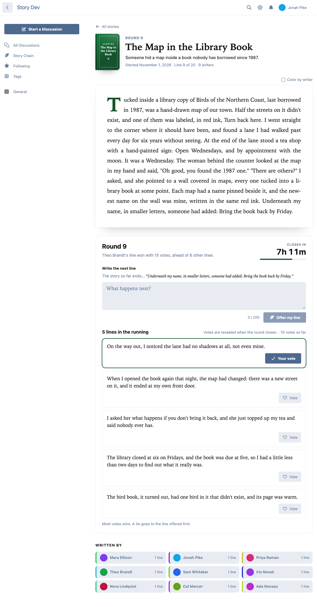
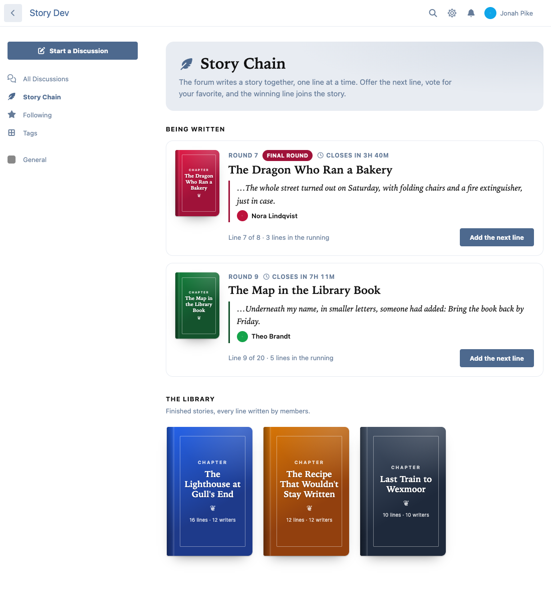
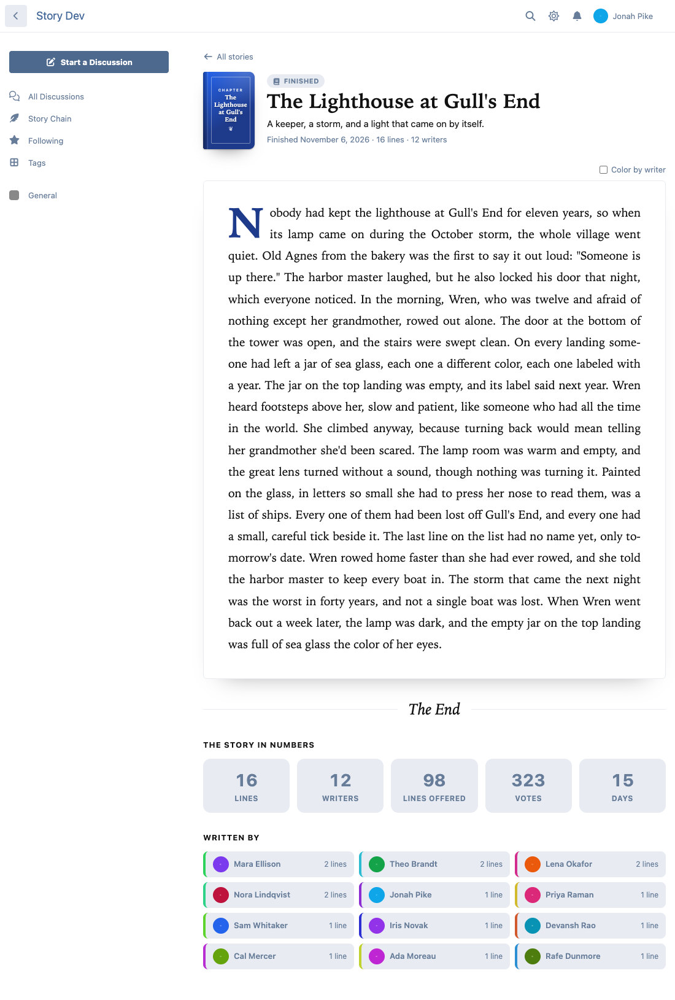

# Story Chain

**The forum writes a story together, one line at a time.** A story starts from an opening line. Every round (a day, by default) members each offer a next line and vote for their favorite; when the round closes, the winning line joins the story, credited to its writer. Finished stories become chapters in a library.

A free [Flarum](https://flarum.org) 2 extension by Ernest Defoe.



## What members get

- **A story that reads like a book.** A clean reading view with a drop cap. Hover, focus or tap any line to see who wrote it, which round it won and by how many votes. "Color by writer" shows everyone's lines at a glance.
- **A round every day.** One line per member per round, up to the story's length limit, with a live countdown to the close. You can take your line back and rewrite it while the round is open.
- **Voting.** One vote per round, which you can move until it closes. Most votes wins; a tie goes to the line offered first. By default votes are counted out of sight and lines are anonymous until one wins, so members vote for the line, not the name (both are admin settings).
- **The library.** When a story reaches its length, or a moderator makes a round the last, it becomes a finished chapter with a cover, its numbers (lines, writers, lines offered, votes, days) and the people who wrote it.
- **Notifications.** "Your line won round 12" (alert and optional email), and "Round 13 is open" for everyone taking part in a story.
- **A card on the discussion list** with the newest line and how long until the round closes. Members can hide it until the next round.
- **/stories**, with the stories being written and the library.



## For moderators

From a story's **Manage** menu: edit it, close the round now, make the open round the last, finish the story, or delete it. Remove any line in the running (its votes go back to the voters), or take a line out of the story itself (positions never shift, and it can be put back).

## Settings and permissions

- Show Story Chain in the sidebar, show the card on the discussion list.
- Show vote counts while a round is open (off by default).
- Show who wrote each line while a round is open (off by default; moderators always see).
- The writer of the newest line sits the next round out (on by default).
- Permissions: read stories (everyone), offer lines and vote (members), start stories and moderate (moderators). Give **Start stories** to members to let them start their own (up to three a day each).

Each story sets its own round length (an hour to a week), length (a set number of lines, or until a moderator ends it), longest line (40–500 characters) and cover.

## Built to be trusted

- Rounds close on Flarum's scheduler every minute. Closing is race-safe and idempotent: two closers at once, or a rerun after a crash, never add a line twice or skip a round. On forums without a running scheduler, a round closes when someone next opens the story.
- Lines and votes are taken under a lock on the story, so nothing lands in a round that is closing.
- Hidden vote counts and anonymous writers are never in the page data, not just hidden on screen.
- Light: about 3.8 KB (gzipped) of JavaScript on every page; the pages load only when opened. The index card adds no database query to page loads.
- Works in dark mode, with themes and on phones. GDPR export and erasure with flarum/gdpr.



## Install

```sh
composer require ernestdefoe/story-chain
php flarum migrate
php flarum cache:clear
```

Flarum's scheduler should be running so rounds close on time.

## Links

- [Packagist](https://packagist.org/packages/ernestdefoe/story-chain)
- [GitHub](https://github.com/ernestdefoe/story-chain)
- [Support](https://ernestdefoe.online)

MIT licensed. ☕ If you like it, consider [buying me a coffee](https://buymeacoffee.com/ernestdefoe).
